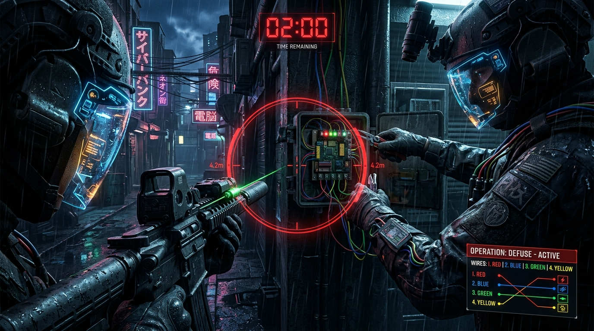
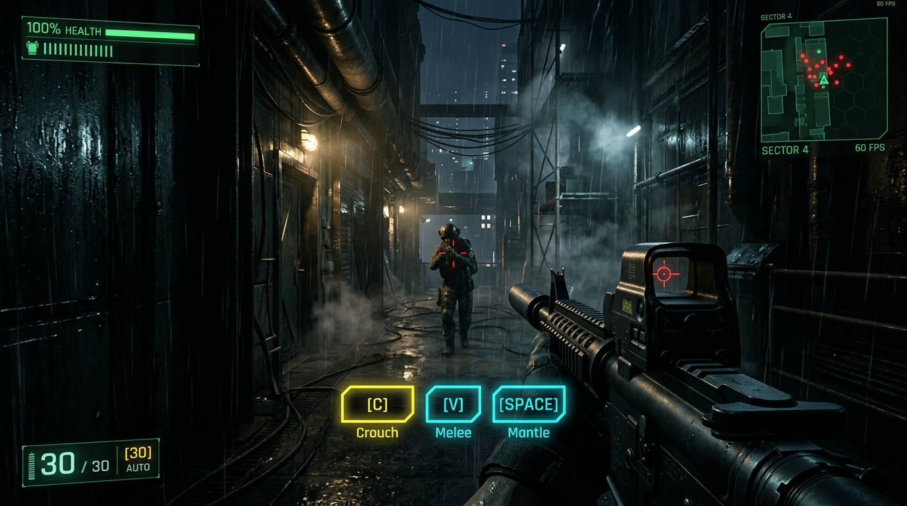
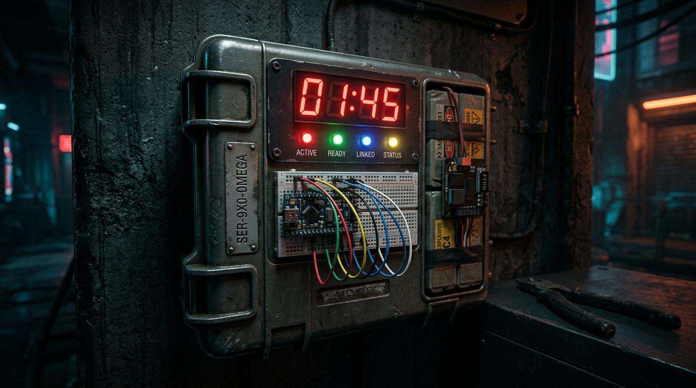
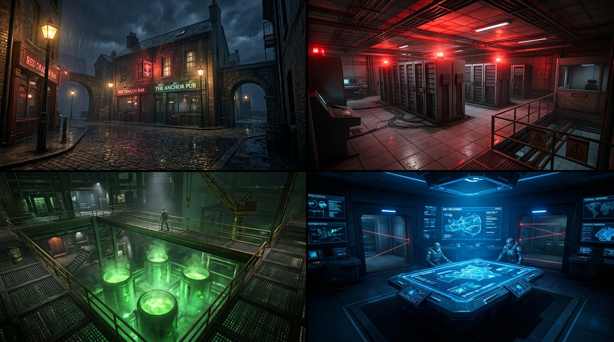
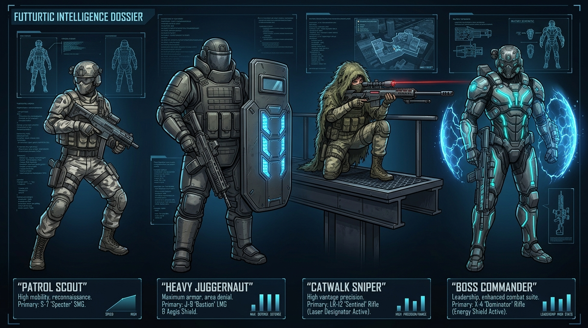
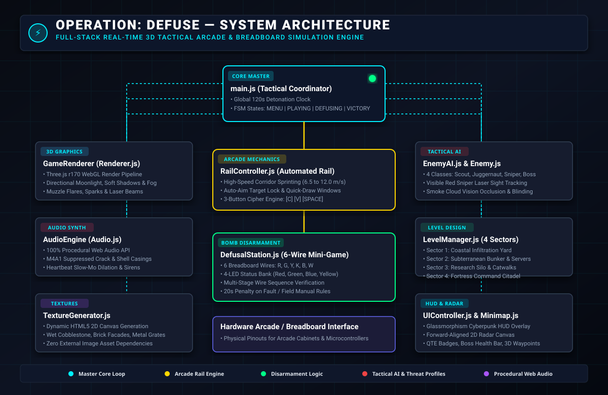
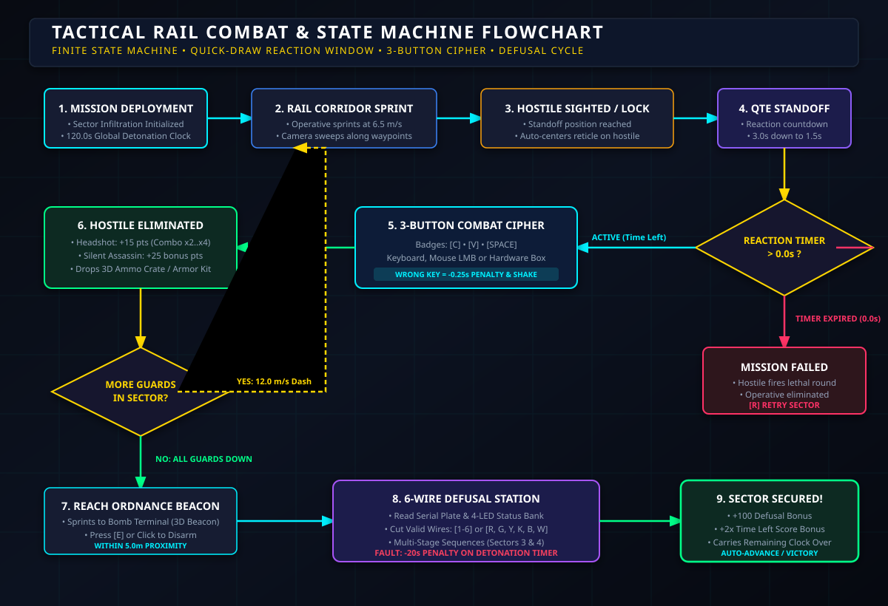
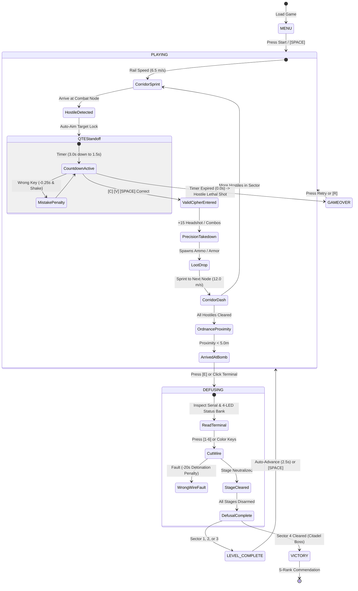
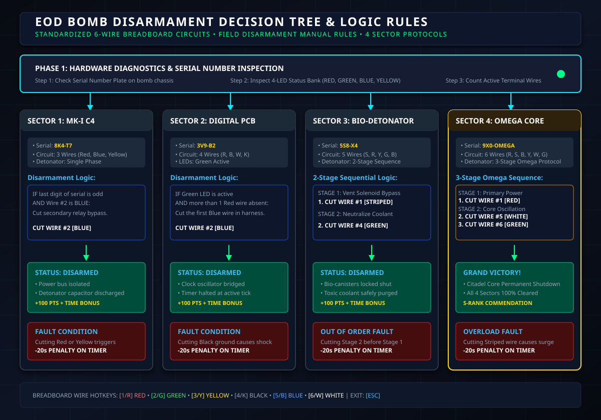
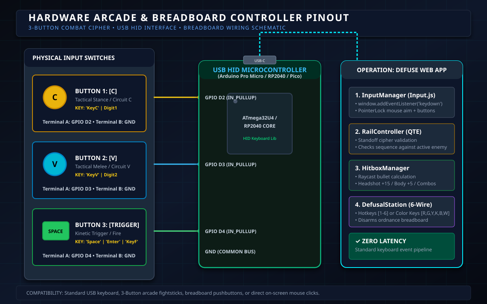

<div align="center">

# 🎯 OPERATION: DEFUSE — Tactical On-Rail FPS & Bomb Disarmament Challenge

[](https://snigdha-0210.github.io/Shoot_Game/)
[](https://snigdha-0210.github.io/Shoot_Game/)
[](https://threejs.org/)
[](https://vitejs.dev/)
[](https://developer.mozilla.org/en-US/docs/Web/API/Web_Audio_API)
[](#-core-gameplay-systems)
[](#-hardware-arcade--breadboard-controller-interface)
[](LICENSE)

<br/>



<br/>

## 🕹️ **[👉 CLICK HERE TO PLAY THE LIVE GAME ONLINE NOW 👈](https://snigdha-0210.github.io/Shoot_Game/)**
### **Live URL:** [https://snigdha-0210.github.io/Shoot_Game/](https://snigdha-0210.github.io/Shoot_Game/)

<br/>

<p align="center">
  <em>A high-octane 3D tactical on-rail arcade first-person shooter and breadboard bomb disarmament simulation built with Three.js, Vanilla Web Audio API, and Vite. Infiltrate hostile facilities, neutralize armed guards across tightening quick-draw standoff reaction windows with a 3-button hardware/keyboard combat cipher, disarm multi-wire explosive ordnance under a continuous 2-minute global countdown, and defeat General Malikov in the Citadel showdown!</em>
</p>

[🎮 Play Online](https://snigdha-0210.github.io/Shoot_Game/) • [📸 Gameplay Showcase](#-gameplay--visual-showcase) • [⚡ Core Systems](#-core-gameplay-systems) • [🏗️ System Architecture](#-system-architecture) • [🔄 Gameplay State Flow](#-gameplay-loop--state-machine-flowchart) • [✂️ Defusal Logic Tree](#-eod-bomb-disarmament-decision-tree--rules) • [🎛️ Hardware Interface](#-hardware-arcade--breadboard-controller-interface) • [🏙️ 4 Sectors](#-the-4-progressive-sectors) • [🪖 Enemy Archetypes](#-specialized-enemy-combat-archetypes) • [🕹️ Controls](#-controls--hardware-hotkeys) • [🚀 Quick Start](#-quick-start--installation)

---

</div>

## 📸 Gameplay & Visual Showcase

<div align="center">

### 🎯 Tactical Rail Combat & In-Game Cyberpunk HUD

*Real-time auto-aim target lock with high-speed corridor rail navigation, active QTE standoff badges (`[C]`, `[V]`, `[SPACE]`), reaction timer bar, dynamic health & ammunition meters, and forward-aligned 2D minimap radar.*

<br/>

### 💣 Interactive 6-Wire Breadboard Bomb Disarmament Terminal

*Authentic electronic breadboard disarming terminal featuring 6 colored wires (Red, Green, Yellow, Black, Blue, White), a 7-segment digital timer display, 4 status indicator LEDs (`RED`, `GREEN`, `BLUE`, `YELLOW`), and procedural Field Manual logic.*

<br/>

### 🏙️ 4 Progressive Cinematic Sector Environments

*Sector 1: Coastal Infiltration Yard • Sector 2: Subterranean Bunker & Server Complex • Sector 3: Research Silo Catwalks & Radioactive Vats • Sector 4: Fortress Command Citadel Holographic War Room.*

<br/>

### 🪖 Tactical Enemy Combat Classes & AI Dossier

*Patrol Scout (High mobility) • Heavy Juggernaut (Full plate armor & riot shield) • Catwalk Sniper (Red laser designator beam) • Citadel Boss General Malikov (Holographic energy shield).*

</div>

---

## ⚡ Core Gameplay Systems

### 1. 🚄 Automated Rail Traversal & Corridor Navigation (`RailController.js`)
- **Dynamic Sprint Speed**: Operatives automatically sprint along predefined level waypoints at **`6.5 m/s`** during corridor exploration and accelerate to **`12.0 m/s`** post-combat dashes.
- **Auto-Aim Precision Lock**: Smooth cinematic camera interpolation directly targets hostile heads and chest weak points upon reaching standoff combat nodes.
- **Smooth Rail Transitions**: Camera position and forward vectors smoothly ease using slerp and cubic velocity curves.

### 2. ⏱️ Tightening Quick-Draw Reaction Windows
Every standoff encounter challenges your reflexes with a shrinking reaction countdown window:
- **Sector 1 (Coastal Yard)**: `3.0s – 2.6s` generous reaction window.
- **Sector 2 (Server Complex)**: `2.4s – 2.1s` moderate reaction window.
- **Sector 3 (Research Silo)**: `2.0s – 1.8s` high-intensity reaction window.
- **Sector 4 (Citadel Core)**: `1.8s – 1.5s` ultra-fast reflexes (`2.4s` for the 4-button Boss sequence).
- **Lethal Standoff Consequence**: Failing to enter the sequence before the timer hits `0.0s` results in the hostile firing a lethal shot and instant mission failure!

### 3. 🎛️ 3-Button Hardware / Arcade Combat Cipher (`[C]`, `[V]`, `[SPACE]`)
Engineered for physical arcade setups and breadboard microcontrollers:
- **Circuit C**: Key <kbd>C</kbd> / Key <kbd>1</kbd> / On-screen Badge *(Tactical Stance / Low Avoidance)*
- **Circuit V**: Key <kbd>V</kbd> / Key <kbd>2</kbd> / On-screen Badge *(Tactical Melee / Override)*
- **Kinetic Trigger**: Key <kbd>Space</kbd> / <kbd>Enter</kbd> / <kbd>F</kbd> / <kbd>Z</kbd> / <kbd>LMB</kbd> *(Precision Shot / Kinetic Trigger)*
- **Mistake Penalty**: Pressing an incorrect button deducts **`0.25s`** from the active reaction countdown, triggers screen shake, and sounds a warning tone.

### 4. ⏳ Continuous 2-Minute (120s) Global Detonation Clock
- A single **`120.0s`** global timer governs the entire infiltration campaign across all 4 sectors.
- Time remaining after disarming carried forward into subsequent sectors.
- Successful defusal awards **`+100 Points`** plus a **`+2x Remaining Time Bonus`**.

### 5. ✂️ Interactive 6-Wire Breadboard Defusal Mini-Game (`DefusalStation.js`)
- **6 Standard Wires**: Red, Green, Yellow, Black, Blue, and White.
- **Status LED Bank**: 4 colored LEDs (`RED`, `GREEN`, `BLUE`, `YELLOW`) govern branching cut rules.
- **Serial Number Diagnostics**: Dynamic alphanumeric serial codes dictate specific wire-cutting combinations.
- **Fault Penalty**: Snipping the wrong wire triggers a violent **`20-second penalty`** on the detonation timer!

### 6. 🔊 100% Procedural Web Audio Synthesis Engine (`Audio.js`)
- Completely synthesized in real time via the **HTML5 Web Audio API** with zero external `.mp3` or `.wav` dependencies:
  - Suppressed M4A1 rifle crack and USP-45 pistol shots
  - High-caliber sniper supersonic cracks and bullet whizzes
  - Shell casing brass clinks and dynamic acoustic reverb
  - Adrenaline bullet-time heartbeat oscillator with low-pass filtering
  - Procedural emergency sirens, wire snipping tones, and victory fanfare

### 7. 🥽 AN/PVS-31A Night Vision Goggles & Catwalk Threat Detection (<kbd>N</kbd>)
- **Tactical Keybind (<kbd>N</kbd>)**: Toggle night vision instantly using <kbd>N</kbd> or the on-screen `[N] NVG` badge in the HUD equipment dock.
- **Procedural CRT Shader & Audio**: Fullscreen phosphor green overlay with CRT scanlines, optic vignette, high-contrast exposure boost (`2.4x`), and realistic capacitor charging whine synthesized via the Web Audio API.
- **Thermal Enemy Silhouettes**: Illuminates every hostile in the sector with a luminous neon-green/white wireframe thermal silhouette, making distant or concealed targets impossible to miss.
- **Dynamic Sniper Laser Tracking**: Catwalk snipers project a continuous world-space crimson targeting laser from their rifle muzzle straight to the operative's eye level.
- **Directional Threat HUD Indicator**: When an enemy aims or fires from elevated positions or off-screen, a pulsing tactical chevron displays their exact bearing and distance (e.g. `⚠️ ELEVATED SNIPER [14.2m]`).

---

## 🏗️ System Architecture

### Visual High-Resolution Architecture Diagram


### Full-Stack Architecture Breakdown

```mermaid
graph TD
    classDef master fill:#0f172a,stroke:#00f0ff,stroke-width:2px,color:#fff;
    classDef engine fill:#131b2e,stroke:#38bdf8,stroke-width:1.5px,color:#fff;
    classDef arcade fill:#131b2e,stroke:#ffd700,stroke-width:2px,color:#fff;
    classDef defuse fill:#131b2e,stroke:#00ff88,stroke-width:2px,color:#fff;
    classDef combat fill:#131b2e,stroke:#ef4444,stroke-width:1.5px,color:#fff;

    Main["<b>main.js</b><br/>Master Coordinator &amp; 120s Timer"]:::master

    Renderer["<b>GameRenderer</b> (Renderer.js)<br/>Three.js WebGL, Lighting, Fog"]:::engine
    Audio["<b>AudioEngine</b> (Audio.js)<br/>Web Audio API Procedural Synth"]:::engine
    TextureGen["<b>TextureGenerator.js</b><br/>Procedural 2D Canvas Textures"]:::engine

    Rail["<b>RailController.js</b><br/>Corridor Sprint &amp; QTE Standoff"]:::arcade
    Hardware["<b>InputManager</b> (Input.js)<br/>PointerLock &amp; 3-Button Cipher"]:::arcade

    Defusal["<b>DefusalStation.js</b><br/>6-Wire Mini-Game &amp; Field Manual"]:::defuse
    BombObj["<b>Bomb.js</b><br/>3D Ordnance, LEDs &amp; Beacon"]:::defuse

    PlayerSub["<b>Player.js</b><br/>Dual Weapons, Adrenaline, ADS"]:::combat
    EnemyAI["<b>EnemyAI.js &amp; Enemy.js</b><br/>4 Archetypes, Snipers, Boss"]:::combat
    Hitbox["<b>HitboxManager.js</b><br/>Raycast Combos &amp; Loot Drops"]:::combat
    Level["<b>LevelManager.js</b><br/>4 Sectors &amp; Set-Pieces"]:::combat

    UI["<b>UIController.js &amp; Minimap.js</b><br/>HUD, QTE Badges, Radar"]:::master

    Main --> Renderer
    Main --> Audio
    Main --> TextureGen
    Main --> Rail
    Main --> Hardware
    Main --> Defusal
    Main --> PlayerSub
    Main --> Level
    Main --> UI

    Rail --> |Auto-Aim Reticle| PlayerSub
    Rail --> |Standoff QTE| UI
    Hardware --> |[C] [V] [SPACE]| Rail
    Hardware --> |Cut Hotkeys 1-6| Defusal
    Level --> |Colliders &amp; Spawns| EnemyAI
    Level --> |Ordnance Entity| BombObj
    PlayerSub --> |Raycast Fire| Hitbox
    Hitbox --> |Headshot / Score| UI
    Defusal --> |Disarm / Penalty| BombObj
```

### Subsystem Directory Reference

| Module | Location | Primary Responsibilities |
| :--- | :--- | :--- |
| **Tactical Master** | [`src/main.js`](src/main.js) | Central loop, 120s global clock, FSM state manager (`PLAYING`, `DEFUSING`, `LEVEL_COMPLETE`, `GAMEOVER`, `VICTORY`). |
| **Rail Controller** | [`src/game/RailController.js`](src/game/RailController.js) | Automated corridor sprint, camera spline smoothing, target lock centering, tightening reaction timer, 3-button QTE cipher. |
| **Defusal Station** | [`src/game/DefusalStation.js`](src/game/DefusalStation.js) | 6-Wire procedural breadboard terminal, LED status analysis, multi-stage cutting logic, timer penalty handler. |
| **Level Manager** | [`src/game/LevelManager.js`](src/game/LevelManager.js) | 4 atmospheric sectors, emergency alert sirens, toxic vats, laser tripwires, holographic war table, rail waypoints. |
| **Enemy AI & Archetypes** | [`src/game/EnemyAI.js`](src/game/EnemyAI.js) & [`src/game/Enemy.js`](src/game/Enemy.js) | Scout, Juggernaut, Sniper, and Boss AI behaviors; visible red sniper laser beam tracking, smoke blinding occlusion. |
| **Hitbox & Scoring** | [`src/game/HitboxManager.js`](src/game/HitboxManager.js) | Precision headshot critical hits (+15), combo multipliers (x2, x3, x4), body shots (+5), silent assassin (+25), damage penalties (-3). |
| **Player Controller** | [`src/game/Player.js`](src/game/Player.js) | First-person controller, dual suppressed weapons (M4A1-S & USP-45), ADS zoom, adrenaline bullet-time slow-mo (0.35x). |
| **Tactical UI & Radar** | [`src/game/UI.js`](src/game/UI.js) & [`src/game/Minimap.js`](src/game/Minimap.js) | Glassmorphism cyberpunk HUD, QTE badges, Boss health bar, 3D world waypoints, forward-aligned 2D minimap radar. |
| **Procedural Audio** | [`src/engine/Audio.js`](src/engine/Audio.js) | Pure Web Audio API synthesizers for weapons, ricochets, bullet-time heartbeats, alert sirens, and wire-cutting clicks. |
| **WebGL Renderer** | [`src/engine/Renderer.js`](src/engine/Renderer.js) | Three.js r170 WebGL engine, directional moonlight, linear depth fog, dynamic shadows, sparks, muzzle flashes. |
| **Texture Generator** | [`src/engine/TextureGenerator.js`](src/engine/TextureGenerator.js) | Procedural canvas texture generator (wet cobblestones, brick facades, circuits, warning hazard stripes). |

---

## 🔄 Gameplay Loop & State Machine Flowchart

### Visual High-Resolution Gameplay Flowchart


### Finite State Machine Overview



---

## ✂️ EOD Bomb Disarmament Decision Tree & Rules

### Visual High-Resolution Decision Tree


### 📋 Standard 6-Wire Breadboard Controls & Hotkeys

| Wire # | Color | Keyboard Digit | Dedicated Key | Breadboard Hardware |
| :---: | :---: | :---: | :---: | :---: |
| **Wire #1** | 🔴 **RED** | <kbd>1</kbd> | <kbd>R</kbd> | Hardware Channel 1 |
| **Wire #2** | 🟢 **GREEN** | <kbd>2</kbd> | <kbd>G</kbd> | Hardware Channel 2 |
| **Wire #3** | 🟡 **YELLOW** | <kbd>3</kbd> | <kbd>Y</kbd> | Hardware Channel 3 |
| **Wire #4** | ⚫ **BLACK** | <kbd>4</kbd> | <kbd>K</kbd> / <kbd>L</kbd> | Hardware Channel 4 |
| **Wire #5** | 🔵 **BLUE** | <kbd>5</kbd> | <kbd>B</kbd> | Hardware Channel 5 |
| **Wire #6** | ⚪ **WHITE** | <kbd>6</kbd> | <kbd>W</kbd> | Hardware Channel 6 |

---

### 📖 Field Manual Solutions Guide (Sector by Sector)

#### 🔹 Sector 1: Coastal Infiltration Yard
- **Device Archetype**: Mk-I Tactical C4 Ordnance
- **Harness Setup**: 3 Wires (`RED`, `BLUE`, `YELLOW`)
- **Serial Number**: `8K4-T7` (Last digit is odd: `7`)
- **Disarmament Rule**: *If the last digit of the serial number is odd and Wire #2 is BLUE, cut Wire #2 to sever the secondary bypass relay.*
- **✅ Action**: Cut **`Wire #2 (BLUE)`**
- **Outcome**: Sector 1 Defused $\rightarrow$ Unlocks Sector 2 (`+100 Points` + `2x Remaining Time Bonus`).

#### 🔹 Sector 2: Subterranean Bunker & Server Complex
- **Device Archetype**: Digital Circuit Breadboard Detonator
- **Harness Setup**: 4 Wires (`RED`, `BLUE`, `WHITE`, `BLACK`)
- **Serial Number**: `3V9-B2` | **Status LED**: `GREEN` Active
- **Disarmament Rule**: *If the GREEN status LED is illuminated and fewer than 2 RED wires are present, cut the first BLUE wire in the harness.*
- **✅ Action**: Cut **`Wire #2 (BLUE)`**
- **Outcome**: Sector 2 Defused $\rightarrow$ Unlocks Sector 3.

#### 🔹 Sector 3: Research Silo & Catwalks
- **Device Archetype**: 2-Stage Bio-Chemical Detonator
- **Harness Setup**: 5 Wires (`STRIPED`, `RED`, `YELLOW`, `GREEN`, `BLUE`)
- **Serial Number**: `5S8-X4`
- **Disarmament Rule (2-Stage Sequential)**:
  1. **Stage 1 (Ground Bypass)**: Cut **`Wire #1 (STRIPED)`** *(Vents pressurized solenoid bypass)*.
  2. **Stage 2 (Capacitor Neutralizer)**: Cut **`Wire #4 (GREEN)`** *(Neutralizes chemical reservoir charge)*.
- **Outcome**: Sector 3 Defused $\rightarrow$ Unlocks Sector 4 Citadel.

#### 🔹 Sector 4: Fortress Command Citadel (Final Showdown)
- **Device Archetype**: Master Citadel Omega Core
- **Harness Setup**: 6 Wires (`RED`, `STRIPED`, `BLUE`, `YELLOW`, `WHITE`, `GREEN`)
- **Serial Number**: `9X0-OMEGA`
- **Disarmament Rule (3-Stage Omega Protocol)**:
  1. **Stage 1 (Primary Bus)**: Cut **`Wire #1 (RED)`** *(Disrupts high-voltage input)*.
  2. **Stage 2 (Oscillation Dampener)**: Cut **`Wire #5 (WHITE)`** *(Halts core oscillations)*.
  3. **Stage 3 (Terminal Ground)**: Cut **`Wire #6 (GREEN)`** *(Severs emergency failsafe ground)*.
- **Outcome**: **Grand Victory Screen** — All 4 sectors secured with **Master Shadow Commando (S-Rank)** rating!

> 📄 **Official Field Manual PDF**: A printable 2-page military manual is available in the repository at [`public/BOMB_DEFUSAL_FIELD_MANUAL.pdf`](public/BOMB_DEFUSAL_FIELD_MANUAL.pdf) or viewable in-game via the web manual at [`public/manual.html`](public/manual.html).

---

## 🎛️ Hardware Arcade & Breadboard Controller Interface

### Visual Hardware Schematic & Pinout


### Arcade / Microcontroller Pinout Table

```
      +-------------------------------------------+
      |      USB HID MICROCONTROLLER (PICO/PRO)   |
      |                                           |
      |  [D2] ---------- Button 1 [C] -------- GND|
      |  [D3] ---------- Button 2 [V] -------- GND|
      |  [D4] ---------- Button 3 [SPACE] ---- GND|
      |                                           |
      |  [USB-C] ====> Host PC Web Browser        |
      +-------------------------------------------+
```

| Microcontroller Pin | Input Button | Default Keycode Sent | Game Function |
| :---: | :---: | :---: | :--- |
| **GPIO D2** | Button 1 | `KeyC` / `Digit1` | **Circuit C** (Crouch / Stance QTE) |
| **GPIO D3** | Button 2 | `KeyV` / `Digit2` | **Circuit V** (Melee / Override QTE) |
| **GPIO D4** | Button 3 | `Space` / `Enter` | **Kinetic Trigger** (Fire / Advance) |
| **GND** | Common Bus | — | Internal Pull-Up Resistor Ground Reference |

### Arduino / RP2040 Microcontroller Code Snippet

```cpp
#include <Keyboard.h>

const int PIN_C = 2;
const int PIN_V = 3;
const int PIN_SPACE = 4;

void setup() {
  pinMode(PIN_C, INPUT_PULLUP);
  pinMode(PIN_V, INPUT_PULLUP);
  pinMode(PIN_SPACE, INPUT_PULLUP);
  Keyboard.begin();
}

void loop() {
  if (digitalRead(PIN_C) == LOW)     { Keyboard.press('c'); delay(50); Keyboard.release('c'); }
  if (digitalRead(PIN_V) == LOW)     { Keyboard.press('v'); delay(50); Keyboard.release('v'); }
  if (digitalRead(PIN_SPACE) == LOW) { Keyboard.press(' '); delay(50); Keyboard.release(' '); }
  delay(10);
}
```

---

## 🏙️ The 4 Progressive Sectors

| Sector | Environment & Atmospheric Set-Pieces | Threat Level | Ordnance Setup |
| :--- | :--- | :---: | :--- |
| **1. Coastal Infiltration Yard** | Dark rainy cobblestone streets, gas lanterns, brick alleys, and neon bar sign (`BAR NOCTURNE`). | 🟡 Normal | Mk-I Tactical C4 (3 Wires) |
| **2. Subterranean Bunker & Servers** | High-security concrete bunker, spinning red emergency alert beacons, server racks with animated LEDs. | 🟠 High | Digital Circuit Detonator (4 Wires) |
| **3. Research Silo & Catwalks** | Industrial bio-chemical research facility, elevated steel catwalks with high-intensity spotlights, bubbling radioactive coolant vats, and elevated sniper perch with red laser tracking and Night Vision support. | 🔴 Severe | 2-Stage Bio-Chemical Detonator (5 Wires) |
| **4. Fortress Command Citadel** | Polished obsidian marble floors, security laser tripwires, holographic 3D war room, General Malikov boss. | 🟣 Extreme | 3-Stage Master Omega Core (6 Wires) |

---

## 🪖 Specialized Enemy Combat Archetypes

| Enemy Class | Armor & HP | Primary Weapon | Tactical Threat Profile |
| :--- | :---: | :--- | :--- |
| 🏃 **Patrol Scout** | Light (25 HP) | Suppressed SMG | High movement velocity, quick corridor flanking, rapid burst fire. |
| 🛡️ **Heavy Juggernaut** | Tank (60 HP) | Heavy Assault Rifle | Ballistic plate armor & riot shield. Requires multiple headshots or rapid burst fire to stagger. |
| 🎯 **Catwalk Sniper** | Medium (30 HP) | High-Caliber Marksman | Perched on elevated catwalks; projects an active **visible red targeting laser**. Locks on for 1.5s before taking a 45-dmg shot! |
| 👑 **Citadel Boss (General Malikov)** | Boss Rig (80 Shield + 60 HP) | Dual Heavy Carbine | Holographic kinetic energy shield, combat rolls, multi-key QTE standoff cipher (4-key sequence), and alert reinforcements. |

---

## 🕹️ Controls & Hardware Hotkeys

### Combat & Movement Controls

| Control | Function | Description |
| :---: | :---: | :--- |
| <kbd>W</kbd> <kbd>A</kbd> <kbd>S</kbd> <kbd>D</kbd> | Move Operative | Manual navigation override (when not locked on automated rail). |
| <kbd>MOUSE</kbd> | First-Person Look | Precision aim via PointerLock mouse capture. |
| <kbd>LMB</kbd> / <kbd>Space</kbd> | Fire Weapon / Trigger | Fires equipped weapon or triggers active QTE action. |
| <kbd>RMB</kbd> | Aim Down Sights (ADS) | Precision optical zoom with reduced weapon sway. |
| <kbd>N</kbd> | Night Vision Goggles (NVG) | Toggles AN/PVS-31A green phosphor thermal optics with CRT scanlines, exposure boost, and luminous enemy thermal silhouettes. |
| <kbd>Q</kbd> or <kbd>1</kbd> / <kbd>2</kbd> | Quick-Swap Weapon | Toggles between Suppressed M4A1-S Carbine and USP-45 Pistol. |
| <kbd>G</kbd> | Smoke Grenade | Deploys volumetric smoke cloud that blinds enemies and blocks line-of-sight for 14s. |
| <kbd>Space</kbd> | Adrenaline Focus | Triggers **0.35x bullet-time slow motion** to line up critical headshots. |
| <kbd>C</kbd> / <kbd>Ctrl</kbd> | Crouch / Stance | Silent stealth movement; also triggers Circuit `[C]` in QTE standoffs. |
| <kbd>V</kbd> | Melee / Override | Quick melee strike; triggers Circuit `[V]` in QTE standoffs. |
| <kbd>Shift</kbd> | Tactical Sprint | Maximum movement velocity. |
| <kbd>R</kbd> | Weapon Reload | Replenishes active weapon magazine. |
| <kbd>F</kbd> | Weapon Flashlight | Toggles tactical illumination. |
| <kbd>E</kbd> | Defusal Terminal | Opens the 6-wire bomb disarmament mini-game within 5.0m range. |
| <kbd>Esc</kbd> | Exit / Pause | Exits the bomb defusal modal or pauses game. |

---

## 🚀 Quick Start & Installation

### Prerequisites
- [Node.js](https://nodejs.org/) (version 18+ or 20+ recommended)
- [npm](https://www.npmjs.com/) (included with Node.js)

### 1. Clone the Repository
```bash
git clone https://github.com/Snigdha-0210/Shoot_Game.git
cd Shoot_Game
```

### 2. Install Dependencies
```bash
npm install
```

### 3. Launch Local Development Server
```bash
npm run dev
```
> The local development server will start at `http://localhost:5173/`. Open this URL in any modern WebGL-supported browser (Chrome, Edge, Firefox, Brave).

### 4. Build for Production
```bash
npm run build
```
> Compiles and bundles production-ready assets into the `dist/` directory.

---

## 📂 Project Structure

```
Shoot_Game/
├── .github/
│   └── workflows/
│       └── deploy.yml                   # Automated GitHub Actions deployment to GitHub Pages
├── docs/
│   └── assets/
│       ├── diagrams/
│       │   ├── system_architecture.svg           # High-resolution vector system architecture
│       │   ├── gameplay_loop_flowchart.svg       # Tactical rail combat state machine flowchart
│       │   ├── bomb_defusal_decision_tree.svg    # EOD 6-wire disarmament decision tree
│       │   └── hardware_controller_schematic.svg # 3-Button arcade/breadboard circuit schematic
│       └── images/
│           ├── hero_banner.jpg                   # Main cinematic hero banner
│           ├── gameplay_combat_hud.jpg           # In-game tactical rail combat HUD screenshot
│           ├── bomb_defusal_terminal.jpg         # 6-Wire electronic breadboard defusal station
│           ├── level_sectors_showcase.jpg        # 4 Cinematic level environments showcase
│           └── enemy_archetypes.jpg              # Tactical enemy classes dossier
├── public/
│   ├── BOMB_DEFUSAL_FIELD_MANUAL.pdf    # Downloadable 2-page EOD Field Manual PDF
│   └── manual.html                      # Interactive web-based Field Manual
├── src/
│   ├── engine/
│   │   ├── Audio.js                     # 100% Procedural Web Audio API sound synthesizer
│   │   ├── Input.js                     # PointerLock, keyboard, mouse & hardware breadboard input
│   │   ├── Renderer.js                  # Three.js r170 WebGL engine, moonlight, shadows & fog
│   │   └── TextureGenerator.js          # Procedural canvas textures (cobblestone, brick, PCB)
│   ├── game/
│   │   ├── Bomb.js                      # 3D C4 ordnance model, LED clock & waypoint beacon
│   │   ├── DefusalStation.js            # 6-Wire breadboard defusal station & procedural puzzle logic
│   │   ├── Enemy.js                     # 3D character models for 4 enemy archetypes
│   │   ├── EnemyAI.js                   # Tactical AI, sniper laser targeting, smoke occlusion
│   │   ├── Grenade.js                   # 3D tactical smoke grenade physics & volumetric clouds
│   │   ├── HitboxManager.js             # Precision raycasting hitboxes, killstreak combos & scoring
│   │   ├── LevelManager.js              # 4 Progressive sectors, animated sirens, vats, laser tripwires
│   │   ├── Minimap.js                   # Forward-aligned 2D tactical radar canvas
│   │   ├── Pickups.js                   # 3D glowing spinning Ammo & Armor loot drops
│   │   ├── Player.js                    # Dual suppressed weapons, recoil, bullet-time slow-mo
│   │   ├── RailController.js            # Automated rail traversal, auto-aim lock & QTE state machine
│   │   └── UI.js                        # Cyberpunk glassmorphism HUD, QTE badges, boss health bar
│   ├── main.js                          # Master coordinator & continuous 120s global game timer
│   └── style.css                        # Cyberpunk HUD styling, glassmorphism overlays & animations
├── generate_manual_pdf.py               # Python ReportLab generator for the PDF Field Manual
├── index.html                           # Main entry point, HUD markup & defusal station modal
├── package.json                         # Project metadata & dependencies (Three.js r170, Vite 6)
├── LICENSE                              # MIT License
├── README.md                            # Comprehensive game documentation & architectural showcase
├── PROJECT_UPDATES.md                   # Chronological development updates & feature roadmap
└── vite.config.js                       # Vite base configuration for GitHub Pages deployment
```

---

## 🌐 Deployment to GitHub Pages

This repository is preconfigured with an automated **GitHub Actions** deployment pipeline located at [`.github/workflows/deploy.yml`](.github/workflows/deploy.yml).

Whenever you push changes to the `main` branch:
1. GitHub Actions checks out the repository.
2. Installs dependencies using `npm ci`.
3. Builds the production bundle via `npm run build`.
4. Automatically deploys the resulting `dist/` directory directly to **GitHub Pages**.

Your live demo is immediately available at:
👉 **[https://snigdha-0210.github.io/Shoot_Game/](https://snigdha-0210.github.io/Shoot_Game/)**

---

## 📄 License

This project is open-source and licensed under the **MIT License** — see the [LICENSE](LICENSE) file for details.

Developed with ❤️ by **[Snigdha-0210](https://github.com/Snigdha-0210)** using **Three.js**, **Web Audio API**, and **Vite**.
